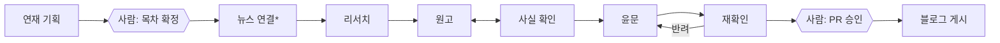

# sagwan-agent

역사 이야기 블로그의 글을 만드는 멀티에이전트. 리서치, 원고, 사실 확인, 윤문은 에이전트가 맡고, 기획과 최종 승인은 사람이 맡는다.

- 블로그: 준비 중 (GitHub Pages)
- 작업 기록: 준비 중
- 상태: 설계 완료, 구현 시작 단계

## 파이프라인



\* 뉴스×역사 카테고리만. 게시는 항상 사람이 PR을 승인(merge)해야 이루어진다.

## 핵심 설계: 독립된 사실 확인

같은 모델이 쓰고 검토까지 하면 자기가 쓴 내용을 그대로 믿기 쉽다. 그래서 사실 확인 에이전트를 원고와 분리했다.

- 사실 확인 에이전트는 **원고만** 받는다. 원고 에이전트의 대화나 리서치 노트, 출처는 받지 않고 직접 다시 검색한다.
- 각색 장면은 원고 단계에서 "사실 뼈대(누가·언제·어디서·무슨 일)"와 "지어낸 부분(대사, 감정)"으로 나눠 표시한다. 사실 확인은 뼈대만 검증한다.
- 출처는 인정(1차 사료 DB, 백과사전, 학술 자료), 보조(위키백과 등), 불인정(개인 블로그, AI 생성 글)으로 등급을 나눈다. 보조 출처만 있는 주장은 "판단 불가"로 사람에게 넘긴다.

프로젝트 이름 "사관(史官)"은 조선의 사관에서 왔다. 왕도 사초를 볼 수 없게 해서 기록의 독립성을 지켰다.

## 같은 파이프라인, 세 가지 구현

1. **직접 짠 에이전트 루프:** 프레임워크 없이 "모델 호출 → 도구 실행 → 결과 전달" 루프를 구현한다.
2. **Claude Code 서브에이전트 버전:** 역할별 지시서만으로 파이프라인을 구성해 역할 분담과 프롬프트를 실험한다.
3. **Python 코드 파이프라인:** 2에서 검증한 구조를 코드로 옮긴다.

세 구현은 같은 역할 정의와 평가 세트를 공유한다. 실제 글은 2로 만들고, 1과 3은 Gemini API로 돌려 같은 평가 세트에서 결과를 비교한다. 모델을 부르는 부분은 갈아 끼울 수 있게 만든다. RAG 없이 웹 검색 같은 도구 호출로 만든다.

## 평가 (예정)

- **사실 확인:** 원고에 틀린 사실(연도, 인물, 인과관계)을 일부러 심고, 몇 개를 잡는지와 맞는 사실을 틀렸다고 한 경우가 얼마나 되는지 측정한다.
- **윤문:** 윤문 전후에 주장이 바뀐 경우를 재확인 단계가 잡아내는지 측정한다.
- **모델 비교:** 같은 평가 세트를 Claude(구현 2)와 Gemini(구현 3)로 돌려 비교한다. 실행마다 역할별 토큰 사용량을 기록한다.

## 시작하기

```bash
git clone https://github.com/JoowonMun/sagwan-agent.git
cd sagwan-agent
cp .env.example .env   # API 키를 채운다 (Git에 올리지 않음)
```
